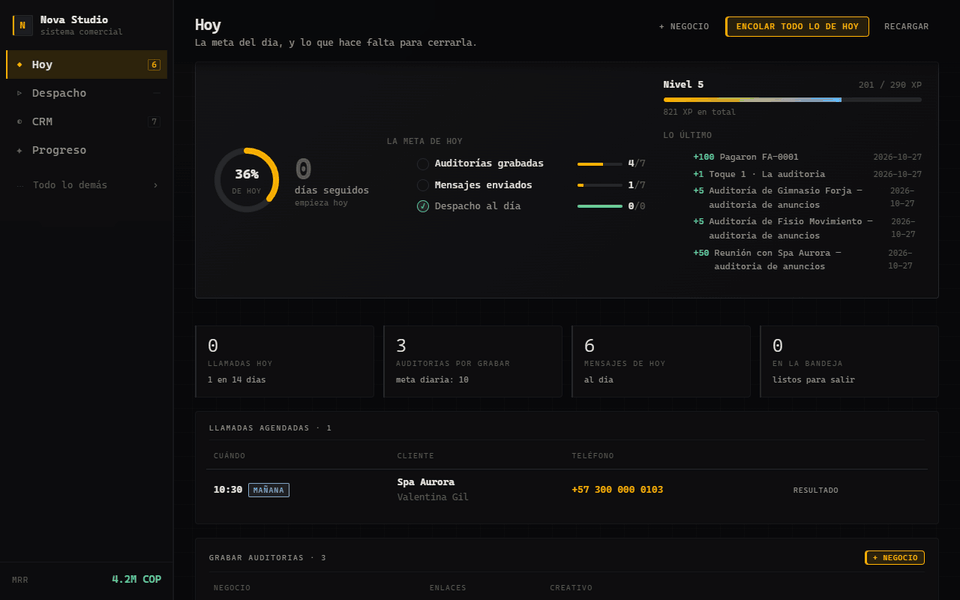

# Agency OS

**Sistema operativo comercial para una agencia de marketing:** prospección, CRM, propuestas, contratos con firma electrónica, suscripciones, facturación multimoneda, producción de contenido y finanzas, en una sola app web que corre en local y guarda los datos en un vault de Obsidian.




*Recorrido con datos ficticios: Hoy, CRM, Panel, una propuesta imprimible, Facturas y Progreso.*

---

## El problema

Una agencia pequeña opera con cinco herramientas que no se hablan: una hoja de prospectos, un CRM, un editor de documentos para propuestas, otro para contratos y una app de facturación. Cada salto entre ellas es una oportunidad de olvidar un seguimiento o de facturar mal.

Agency OS une el ciclo completo en un solo flujo, donde cada paso genera el siguiente con los datos ya cargados:

```
Prospección → CRM → Diagnóstico → Propuesta ─(el cliente acepta)→ Contrato ─(firma)→ Suscripción → Factura mensual
                                                                                          ↓
                                                                              Onboarding · Producción · Reportes
```

## Funcionalidades

- **Pantalla «Hoy»**: llamadas agendadas, auditorías por grabar, mensajes que salen hoy y bandeja de salida. Cuando las cuatro listas están vacías, el día está hecho.
- **Prospección por lotes**: pegas texto tabular y sale convertido en clientes, oportunidades y secuencias de 5 toques programadas.
- **Documentos con enlace público**: el cliente abre la propuesta, el contrato o la factura en el móvil y la acepta, firma o paga ahí mismo. Cada apertura queda registrada.
- **Facturación multimoneda** (COP, USD, MXN) con consecutivo por serie, IVA, retención y control de mora.
- **Producción**: los compromisos del mes salen de los entregables del catálogo, y cada pieza avanza por su propio flujo (borrador → revisión → aprobado → publicado).
- **Automatizaciones diarias** que corren solas mientras el servidor esté encendido, y recuperan los días perdidos si el equipo estuvo apagado.
- **Integración con agentes de IA** (Claude Code): una cola de trabajos en markdown que los agentes procesan y cuyos resultados la app importa.
- **Capa de progreso**: XP, rachas y niveles derivados de la actividad real del CRM.

## Stack

| Capa | Tecnología |
|---|---|
| Servidor | Node.js, Express 4 |
| Correo | Nodemailer (SMTP con contraseña de aplicación por variable de entorno) |
| Frontend | JavaScript vanilla sin framework ni build, SPA de ~20 vistas; Web Animations API |
| Persistencia | Archivo JSON con escritura atómica y respaldos rotativos, más espejos `.md` para Obsidian |
| Exposición pública | Túnel de Cloudflare (`cloudflared`) para los enlaces de clientes |
| Pruebas | Runner propio en Node: 10 suites de unidad, API e interfaz |

## Aspectos técnicos destacados

### 1. Control de acceso que resiste túneles y proxies
El servidor escucha en toda la red, así que decidir quién es "local" no puede basarse en `req.ip` (con `trust proxy` sale de una cabecera falsificable). La regla exige dos condiciones a la vez: que el **socket sea realmente loopback** y que la petición **no traiga cabeceras de proxy**. Así un atacante en el mismo wifi falla la primera, y un visitante por el túnel de Cloudflare —que se conecta desde `127.0.0.1`— falla la segunda. El resto entra con una llave comparada con `crypto.timingSafeEqual`, y las rutas públicas pasan por un limitador de peticiones. → [`lib/auth.js`](lib/auth.js)

### 2. Firma electrónica con paquete de evidencia
Al firmar un contrato desde su enlace se guardan nombre, correo, IP, marca de tiempo y la **huella SHA-256 del texto exacto aceptado**: el conjunto de evidencia que pide ESIGN/UETA para una firma electrónica simple. Los tokens de enlace se generan solo cuando se comparten (un token que no existe no puede filtrarse) y se pueden revocar. → [`lib/publicdocs.js`](lib/publicdocs.js)

### 3. Planificador diario con recuperación
Un "reloj" ejecuta cada mañana las tareas de mantenimiento: cierra secuencias agotadas, marca facturas en mora, vence propuestas, reclama llamadas sin resultado. Si el equipo estuvo apagado, detecta el día pendiente y lo ejecuta al arrancar. La frontera de lo automático está escrita en código: **nada que salga hacia un cliente corre solo**, y facturar (asignar un consecutivo contable) viene apagado por defecto. → [`lib/reloj.js`](lib/reloj.js)

### 4. Ingesta y secuenciación de prospectos
El importador reconoce columnas aunque vengan desordenadas, **deduplica por nombre, dominio, teléfono y correo** contra lo que ya existe, y reparte la inscripción en la secuencia según la meta diaria para que no venzan 200 toques el mismo día. El validador normaliza montos como `3.500.000` o `1,800.50` y rechaza lo que no es un número, en vez de dejar que un `NaN` se propague hasta el total de una factura. → [`lib/prospecting.js`](lib/prospecting.js), [`lib/sequences.js`](lib/sequences.js), [`lib/validate.js`](lib/validate.js)

**Además:** el XP de la capa de progreso **se deriva, no se almacena** — cada punto se recalcula de marcas de tiempo que ya existen en el CRM, así que no hay contador que inflar ([`lib/juego.js`](lib/juego.js)). La interfaz usa curvas de spring críticamente amortiguado, animaciones interrumpibles con WAAPI y respeta `prefers-reduced-motion`, `prefers-reduced-transparency` y `prefers-contrast`.

## Estructura

```
server.js            API REST, rutas públicas y servidor estático
lib/
  auth.js            llave de acceso, regla de loopback y límite de peticiones
  publicdocs.js      enlaces públicos, aceptación y firma con evidencia
  reloj.js           automatizaciones diarias con recuperación de días perdidos
  sequences.js       secuencias de seguimiento de 5 toques
  prospecting.js     importación de lotes y deduplicación
  outbox.js          bandeja de salida y envío SMTP
  marketing.js       registro de piezas, evidencia y veredictos
  money.js · dates.js · validate.js
  juego.js           XP, metas diarias y rachas derivadas del CRM
public/              SPA en JavaScript vanilla (una vista por archivo)
test/                10 suites y su runner
docs/MANUAL.md       manual de uso completo
```

## Ejecutar

Requiere Node.js 18 o superior.

```bash
npm install
npm start            # http://localhost:4180
```

Los datos se guardan en `~/Documents/Obsidian Vault/Agency/`. Para usar otra carpeta:

```bash
OBSIDIAN_VAULT=/ruta/al/vault npm start
```

Variables de entorno opcionales:

| Variable | Uso |
|---|---|
| `PORT` | Puerto del servidor (por defecto 4180) |
| `OBSIDIAN_VAULT` | Carpeta raíz de los datos |
| `AGENCY_SMTP_PASS` | Contraseña de aplicación SMTP para que los correos salgan solos. Nunca se guarda en disco |

## Pruebas

```bash
npm test
```

Levanta el servidor en el puerto 4199 y corre 10 suites: acceso, dinero, reloj, unidades, marketing, juego, calculadora, API, despacho e interfaz. Los registros que crean llevan la marca `ZZTEST` y se borran al terminar, y cada escritura deja un respaldo.

## Documentación

El manual de uso, módulo por módulo, está en [`docs/MANUAL.md`](docs/MANUAL.md).
